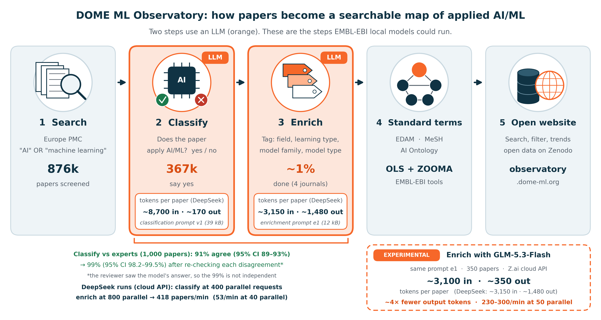

# DOME ML Observatory: request to use EMBL-EBI's local LLMs

## What it is and why it matters
- The DOME ML Observatory (observatory.dome-ml.org) is an open, searchable map of life-science papers that actually **use** AI or machine learning.
- It only counts papers where the authors apply AI/ML in their own work. It leaves out:
  - passing mentions
  - reviews and meta-analyses
  - chatbot question-and-answer studies
  - purely theoretical papers
- Each paper is tagged with its research field, the type of learning, and the model used. This lets people:
  - find methods like theirs
  - see trends across journals and years
  - study how well AI/ML work is reported (the DOME recommendations)

## Work to date
- **Screened 876,000** Europe PMC papers that mention "artificial intelligence" or "machine learning". **367,000** are applied AI/ML papers.
- **Checked against experts.** About 6,400 papers were labelled by hand, half yes and half no.
  - On a held-out set of 1,000, the model agreed with the experts **91%** of the time (95% CI 89–93%).
  - We re-checked every disagreement. In 82 of 97 cases the expert label was wrong. After correcting these, agreement is **99%** (95% CI 98.2–99.5%).
  - Because the reviewer could see the model's answer during re-checking, the 99% figure is an upper estimate. The 91% figure is fully independent.
  - The model is not perfect. It reads only the title and abstract, so it can miss AI/ML use described only deep in the full text.
- **Standard vocabularies.** Tags use EDAM for research fields, and MeSH and the AI Ontology for model terms. These were matched using EMBL-EBI's OLS and ZOOMA services.
- **Enrichment (adding the tags) is best effort.** It is hard to benchmark, especially across biology sub-fields and with a fixed list of tags.
- **Only 4 journals enriched so far** (Bioinformatics, Nature, Science, Cell): 3,500 papers, about 1% of the total. It uses a "thinking" model (DeepSeek V4 Flash), which writes a lot of output per paper. That makes it costly to run at scale.

## The request
- I understand EMBL-EBI's local cluster LLMs are under-used.
- I would like to enrich many more journals. So far I have paid for this myself and cannot continue to.
- Open "thinking" models should do this job well. I tested **GLM-5.3-Flash** on the same papers, with the same instructions as DeepSeek:
  - It returned valid, usable tags for every paper.
  - On 100 papers, it agreed with DeepSeek on the type of learning for 89% (95% CI 81–94%) and on the top-level field for 74% (95% CI 65–82%).
  - It is less precise on model names. Even so, imperfect tags are much better than no tags, and the fixes are known: a simple clean-up step and one extra instruction.
- I can tune the instructions to whichever local model is available.
- I would welcome guidance from Helen's team on:
  - the approach
  - checking tag correctness
  - a clear scoring rubric, ideally with some expert input

## Compute needed (estimates)
- **Tokens per paper for enrichment:**
  - **Reference (DeepSeek V4.1-Flash, production):** about **3,150 in and 1,480 out**, so roughly **4,600 tokens** in total.
  - **Experimental (GLM-5.3-Flash, 350 test papers, same prompt):** about **3,100 in and 350 out**, so roughly **3,500 tokens** in total. It thinks less, so it writes about 4× fewer output tokens.
- **Goal:** cover 10–30% of journals, taking the largest journals first.

| Coverage | Journals | Papers | Tokens: DeepSeek reference | Tokens: GLM-5.3 test |
|---|---:|---:|---:|---:|
| 10% of journals | 829 | 269,000 | 1.24 billion | 0.93 billion |
| 30% of journals | 2,488 | 309,000 | 1.43 billion | 1.07 billion |
| All applied AI/ML papers | 8,294 + preprints | 361,000 | 1.67 billion | 1.25 billion |

- A different local model would likely fall somewhere between these two columns.
- About 75–80% of each request is the same fixed instruction text, so prompt caching reduces the real load a lot.
- **Speed so far (all on cloud APIs, sending many requests in parallel):**
  - DeepSeek classify: run with 400 parallel requests.
  - DeepSeek enrich: 418 papers per minute with 800 parallel requests, and 53 per minute with 40.
  - GLM-5.3-Flash enrich (test): 230–300 papers per minute with 50 parallel requests.
- **On a local deployment, speed depends on the GPUs and serving software.** With a batching server such as vLLM, one copy of the model can work on many papers at once. My pipeline lets me set the number of parallel requests anywhere from 1 upwards, and it can pause and resume. It can run in the background at whatever rate suits the cluster.
- **Request settings I use:**
  - an OpenAI-style chat API
  - temperature 0
  - JSON output
  - thinking on
  - up to 16,000 output tokens
  - about 15,000 tokens of context per request

  I can adjust any of these to suit the cluster. It would help to know the serving setup (e.g. vLLM) and how many parallel requests are allowed.

Contact: Gavin Farrell · observatory.dome-ml.org
